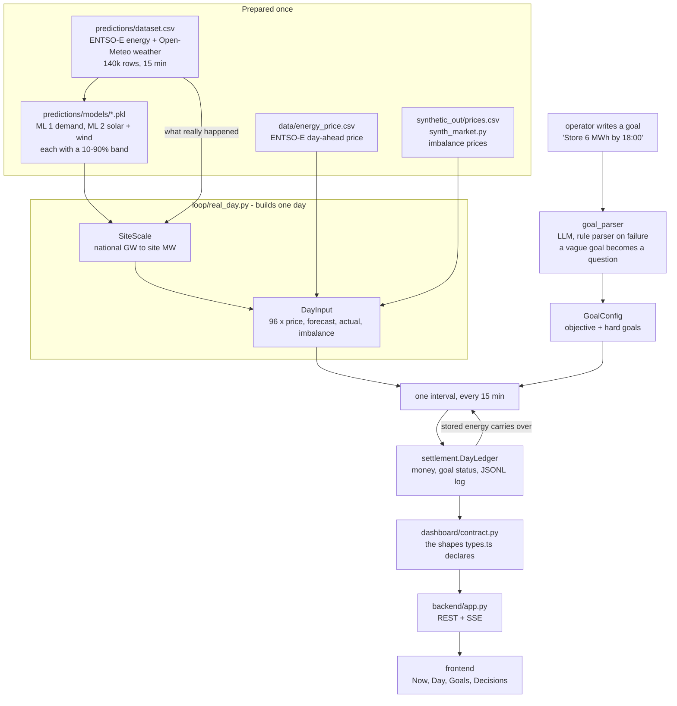
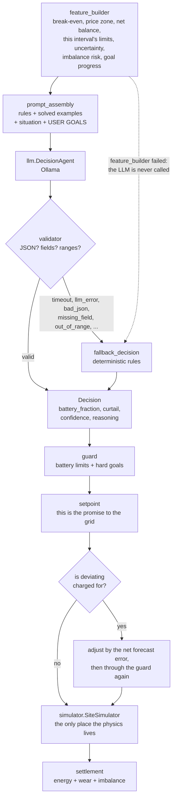
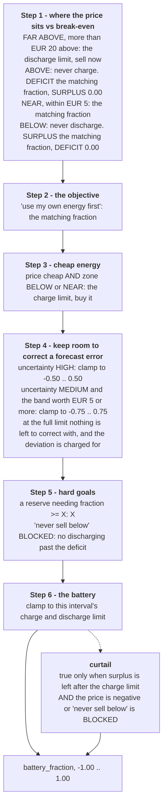
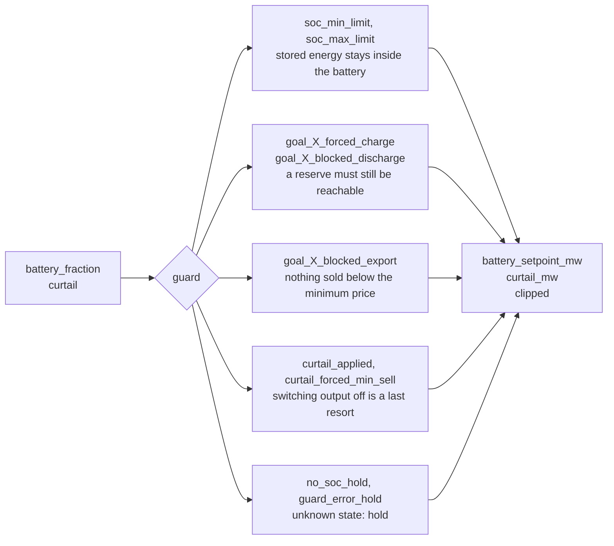

# GitRekt
Smarthack 2026

## Pipeline

What feeds the agent, and where its decisions end up.



### One interval

`pipeline.run_cycle(features, goal_config)` runs the middle of this end to end and never
raises; `loop.DayRunner.step()` adds the physics, the money and the balancing around it.



The LLM only ever advises. Every path ends at the guard, and the guard is the last word.

## Decision making

The prompt walks the model through six steps in order; each may change the value, and the
last change wins. All the comparisons are precomputed, so the model only compares labels.



Then the guard checks the answer against the physics and the hard goals. It may clip
anything, and whatever it applies is named in `applied_rules` so the dashboard can say why.



## Run a day

```powershell
python -m loop                        # a made-up demo day, rule-based fallback only (instant)
python -m loop --date 2026-06-15      # a real day: ML forecasts + ENTSO-E day-ahead prices
python -m loop --date 2026-06-15 --llm --model qwen3.5:latest --goals "Store 6 MWh by 18:00"
```

`--date` replays a real day end to end. The forecasts are issued at the day-ahead gate
(12:00 local the day before), so the models only see what was known then, and the books
are settled against what was actually measured — the printed forecast error is honest.
`--plan` settles on the forecasts instead, for a day that has not happened yet.

## Imbalance: paying for being wrong

A setpoint is chosen on the forecast and the grid balances whatever really happens, so a
forecast error leaves the site short or long of what it promised. `--imbalance` prices
that gap the way a market does — energy promised and not delivered is bought back above
the day-ahead price, energy delivered unasked is sold below it — and lets the battery
defend the promise, within whatever the guard and its own limits allow:

```powershell
python -m loop --date 2026-06-15 --imbalance
```

Without it the uncertainty the models work out is only a label: being wrong costs the
same as being right, so there is nothing to hedge. With it the 10–90 % band has a price,
and what the battery is really for becomes visible. The same hour of 2026-06-15, with the
battery starting empty:

| | profit | without a battery | the battery added |
|---|---|---|---|
| deviation not priced | −9.84 | +19.72 | **−29.55** |
| deviation priced | −3.20 | −90.31 | **+87.11** |

The battery's measured value changes sign: without one, nothing absorbs the error and the
penalty lands in full. Prices come from `synthetic_out/prices.csv` (`synth_market.py`), so
they are synthetic even on a real day; the day-ahead price stays the real ENTSO-E one and
the pair is clamped so deviating can never pay better than delivering the plan.

| Module | Role |
|---|---|
| `predictions/` | ML 1 + ML 2: demand and production forecasts (solar, wind, total) with 10–90 % ranges for any 15-min timestamp up to 7 days ahead; `DemandForecaster`, `ProductionForecaster` and an HTTP API (see `predictions/README.md`) |
| `loop/` | The clock: one day, interval by interval. `demo_day()` makes a day up; `real_day()` builds one from the ML models and the real price file, scaled from national to site size by `SiteScale` |
| `dashboard/` | The loop's objects as the shapes `frontend/src/api/types.ts` declares, so the API layer has nothing left to translate |
| `backend/` | FastAPI: the dashboard's routes and the SSE stream, running the day loop on a worker thread |
| `simulator/` | The site's physics: what the battery, the export limiter and the grid actually did in one interval |
| `goal_parser/` | Plain-language goals → `GoalConfig`; `GoalStore` keeps the active config |
| `feature_builder/` | All the arithmetic: section 8 of the prompt and goal progress |
| `prompt_assembly/` | Rules, solved examples, current situation and USER GOALS → one prompt |
| `llm/` | The shared Ollama client and the decision agent |
| `validator/` | Parses and checks the LLM output; rule-based fallback on any failure |
| `guard/` | Physical limits and hard goals → safe battery setpoint and curtailment |
| `settlement/` | The cashier: grid import/export, energy cost, wear, profit and new SoC per interval (on actual values); goal status (met / missed / violated, "6 MWh reached at 16:00"); day metrics, JSONL log, goal cost vs a profit-only run |
| `battery.py` | `BatteryConfig`, the one battery definition |
| `config.py` | `Settings`: Ollama host, models, timeouts, battery (from environment variables) |
| `common.py` | Small shared helpers |

Run the tests with `pytest -q` (see `tests/README.md`).

## Data visualization

Create and activate the virtual environment, then install the dependencies:

```powershell
python -m venv .venv
.\.venv\Scripts\Activate.ps1
python -m pip install -r requirements.txt
```

Generate the parsed dataset and plots:

```powershell
python visualize_data.py
```
