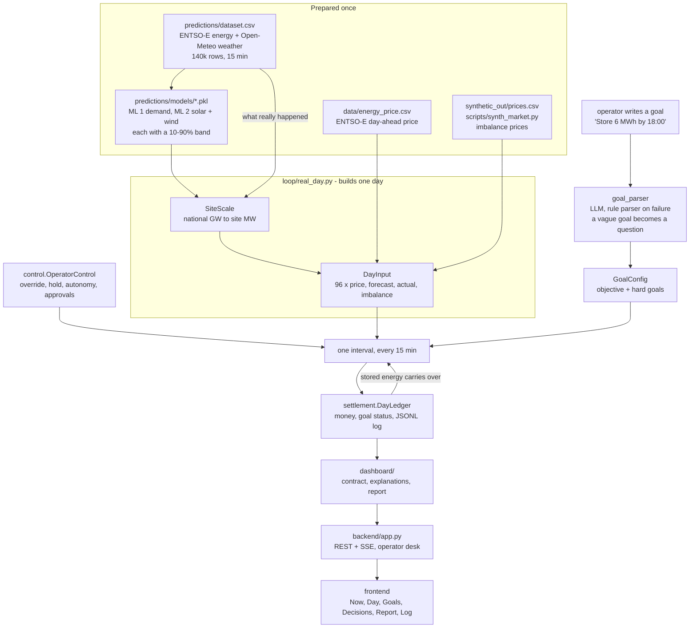
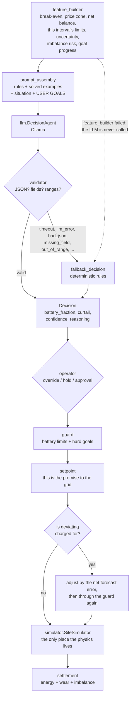
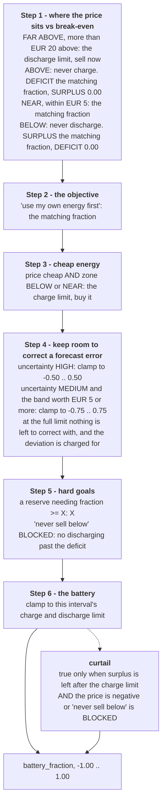
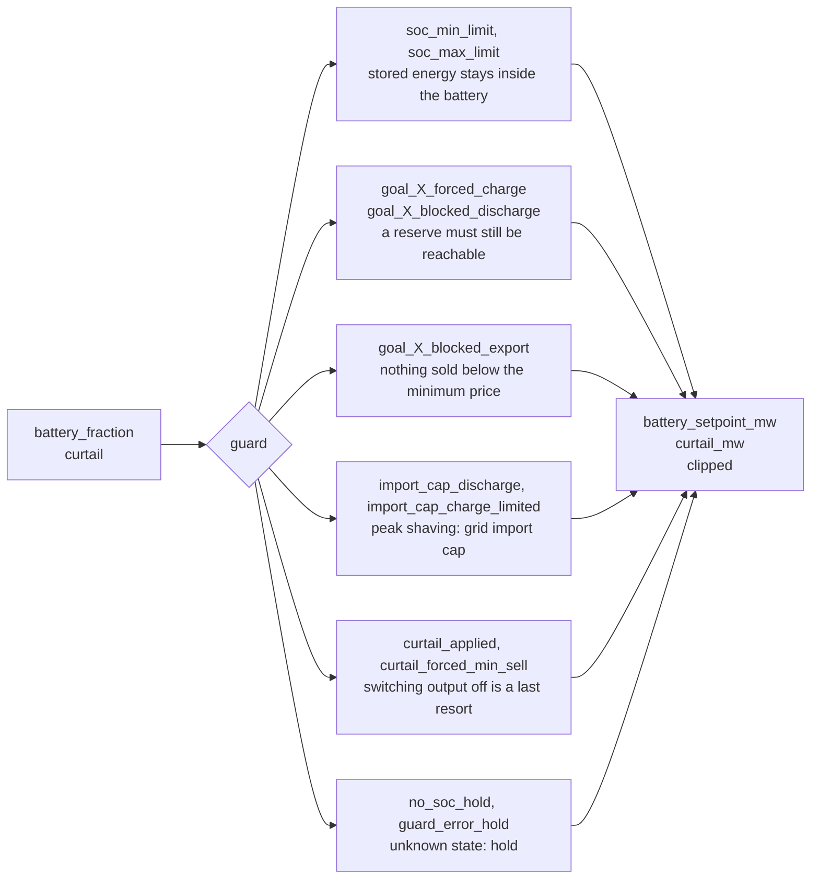

# GitRekt — an LLM energy agent for a battery site

**Smarthack 2026**

GitRekt runs a battery next to a solar and wind site on the Romanian grid. Every 15 minutes it
looks at the price, the forecasts and the operator's goals, then decides whether to charge,
discharge, hold or curtail. A local LLM (Ollama) proposes the move and a deterministic safety
layer has the final say. The dashboard shows what happened and why, in plain language and with
the real numbers.

- **Real data.** Load, generation and day-ahead prices for Romania from the
  [ENTSO-E Transparency Platform](https://transparency.entsoe.eu/), plus weather from
  [Open-Meteo](https://open-meteo.com/), every 15 minutes from 2022-11-07 to 2026-11-07
  (140k rows).
- **Own forecasts.** LightGBM models for demand, solar and wind at any lead time up to 7 days,
  each with a calibrated 10–90 % band.
- **Goals in plain language.** Operators write goals like *"Store 6 MWh by 18:00"* or *"Never
  sell below 50 EUR/MWh"*. These become hard rules, and a vague goal gets a clarifying question back.
- **The LLM only advises.** Every decision goes through a validator, a rule-based fallback and a
  guard that enforces the battery's physics and the hard goals.
- **Honest money.** A settlement ledger books energy, battery wear and (optionally) imbalance
  penalties against what was actually measured, not against the forecast.
- **Humans stay in charge.** Manual override, emergency hold, three autonomy levels with approvals,
  alerts, planned interventions, decision flags and a full audit log.
- **Explained.** Each decision gets an explanation built from its own numbers, and an end-of-day
  report says what the battery did and what it was worth.

---

## Contents

1. [Quick start](#quick-start)
2. [The dashboard](#the-dashboard)
3. [How it works](#how-it-works)
4. [Decision making](#decision-making)
5. [Operator control](#operator-control)
6. [Imbalance: paying for being wrong](#imbalance-paying-for-being-wrong)
7. [Forecasting (ML 1 + ML 2)](#forecasting-ml-1--ml-2)
8. [Data](#data)
9. [Command line](#command-line)
10. [Configuration](#configuration)
11. [HTTP API](#http-api)
12. [Project layout](#project-layout)
13. [Tests](#tests)
14. [License](#license)

---

## Quick start

There are three ways to run it. Every option serves the dashboard at **http://localhost:5173**.

### 1. Docker (recommended, everything included)

With Docker Desktop (or Docker Engine + Compose ≥ 2.24) running, from the repository root:

```bash
docker compose up --build
```

This starts Ollama, pulls and warms the default model (`qwen3.5:4b`), starts the mock price API,
starts the backend in LLM mode on the **presentation day, 2026-09-28**, and serves the built
dashboard through nginx.
On that day solar is almost free at midday (about EUR 9/MWh, with a 4–6 MW surplus) and the
evening peak goes above EUR 300/MWh. The first run takes a few minutes and needs disk space for
the model. Stop it with `Ctrl+C` or `docker compose down`.

Pick another model or day:

```powershell
# Windows PowerShell
$env:ENERGY_AGENT_MODEL = "qwen3:4b"; $env:ENERGY_AGENT_GOAL_MODEL = "qwen3:4b"
$env:ENERGY_AGENT_DATE = "2026-06-15"
docker compose up --build
```

```bash
# macOS / Linux
ENERGY_AGENT_MODEL=qwen3:4b ENERGY_AGENT_GOAL_MODEL=qwen3:4b ENERGY_AGENT_DATE=2026-06-15 \
  docker compose up --build
```

Compose overlays:

| File | Use it when |
|---|---|
| `docker-compose.gpu.yml` | Linux with an NVIDIA GPU (needs the NVIDIA Container Toolkit; check with `docker run --rm --gpus all ubuntu nvidia-smi`) |
| `docker-compose.host-ollama.yml` | You already run Ollama on the machine. On a Mac this is the fast option, because Ollama inside Docker is CPU-only there. On Linux, Ollama must listen on `0.0.0.0:11434` |

```bash
docker compose -f docker-compose.yml -f docker-compose.gpu.yml up --build
docker compose -f docker-compose.yml -f docker-compose.host-ollama.yml up --build
```

### 2. Local launcher (Python + Node.js)

You need Python 3.11+ and Node.js 20+. Install the Python packages once:

```powershell
python -m venv .venv
.\.venv\Scripts\Activate.ps1          # macOS/Linux: source .venv/bin/activate
python -m pip install -r requirements.txt
```

**Windows:**

```powershell
.\scripts\run_app.ps1                     # real day 2026-09-28, LLM decisions (Ollama must be running)
.\scripts\run_app.ps1 -Date 2026-06-15    # another real day
.\scripts\run_app.ps1 -Date ""            # the made-up demo day
.\scripts\run_app.ps1 -Start 11:15        # pre-run the day up to 11:15
```

It opens the backend (port 8001) and the dashboard in two PowerShell windows, and installs the
frontend packages on the first run. To run without Ollama, set `$UseLLM = $false` at the top of
`scripts/run_app.ps1`. Decisions then come from the rule-based fallback.

**macOS / Linux:**

```bash
scripts/run_app.sh                          # demo day, rule-based decisions, no Ollama needed
scripts/run_app.sh --llm --model qwen3:4b   # LLM decisions (Ollama running on the machine)
scripts/run_app.sh --date 2026-09-28        # a real day
scripts/run_app.sh --start 11:15            # pre-run the day up to 11:15
```

Both processes run in one terminal, and `Ctrl+C` stops them. If Node.js is missing, the
dashboard dev server runs in Docker.

### 3. Dashboard only, with mock data

```bash
cd frontend && npm install && npm run dev
```

The whole API is simulated in the browser (`frontend/src/mocks/`), so no Python or Ollama is
needed. This is handy for UI work or a backup demo.

---

## The dashboard

React + TypeScript + Vite, Tailwind CSS, Recharts, TanStack Query and Server-Sent Events for
live updates. The sections are kept in the URL hash:

| Tab | What it shows |
|---|---|
| **Now** | The current action and its reason, a power-flow schematic, the decision trace (forecast → AI → check → safety → battery), what the battery's energy was worth, and the day so far |
| **Day** | All 96 quarter-hours: price, stored energy, production vs demand. Past intervals are measured and later ones are forecast |
| **Goals** | Type a goal as you would say it on the phone. You see its live status (on track / met / missed / violated), and any question the parser sends back |
| **Decisions** | Every decision since 00:00, latest first, with filters, who decided it (AI, backup rules, operator, adjusted by the safety layer), the AI's reasoning and a flag button |
| **Report** | The end-of-day report: charge/discharge phases, key decisions, safety interventions, goal outcomes, operator actions and money. Can be printed or saved as PDF, with an optional AI-written summary that may only use numbers from the report |
| **Log** | The operator audit log: overrides, goal changes, flags, ignored alerts, simulation settings |

A strip on every page holds the **emergency hold**, pending **approvals** and the **simulation
controls**: run at 1×, 60× or 600×, pause, restart at 00:00, or move on to the next day.

---

## How it works

What feeds the agent, and where its decisions end up.



### One interval

`pipeline.run_cycle(features, goal_config)` runs the middle of this from start to finish and
never raises. `loop.DayRunner.step()` wraps it with the operator's commands, the physics, the
money and the balancing.



The LLM only ever advises. Every path ends at the guard, even an operator override, and the
guard always has the last word.

### Backend runtime

- **One worker thread owns the day.** It runs intervals at the requested speed with fixed
  deadlines, so there is no drift. If an LLM call is slower than the slot, the next interval
  starts right away.
- **Reads never wait for the LLM.** After every interval the worker publishes a snapshot, and
  the routes read that snapshot.
- **Commands are applied between intervals**, never inside one. New goals, deleted goals and
  plans take effect from the next interval.
- **The SSE stream** pushes each new interval (`cycle`), every control change (`control`) and
  every new alert (`alert`). It notices closed tabs and pings every 15 s.

---

## Decision making

The prompt walks the model through six steps in order. Each step may change the value, and the
last change wins. All comparisons are precomputed, so the model only has to compare labels.



Then the guard checks the answer against the physics and the hard goals. It may clip anything,
and each rule it applies is listed in `applied_rules` so the dashboard can say why.



### Explanations

Small models are unreliable at prose. Their sentences rarely hold numbers and sometimes
contradict the action. So the explanation the operator reads (`dashboard/explain.py`) is built
deterministically from the **settled** record. It has a one-sentence summary with numbers,
supporting facts (grid, money, the next price peak), what the battery's energy was worth in that
interval, what the safety layer changed, and the AI's own note, kept only if it does not
contradict what happened.

---

## Operator control

`control/operator.py` and `backend/desk.py` let a person step in at any time:

| Tool | What it does |
|---|---|
| **Override** | Run a fixed setpoint until HH:MM. The guard still checks it |
| **Emergency hold** | Battery idle and nothing exported until released. The AI is not asked |
| **Autonomy** | `autonomous`: AI decisions run as they are. `supervised`: big or low-confidence moves wait for approval. `advisory`: every move waits. If no answer comes before the timeout, the battery holds |
| **Plan ahead** | Set the battery for a specific upcoming interval (or skip it). The AI is not asked for that slot |
| **Alerts** | Goal behind or unreachable, backup rules 3× in a row, price spike in the next 2 h, forecast off. Each alert clears itself when its condition clears and can be ignored until it comes back |
| **Relax a goal** | Lower a reserve goal to what can still be stored by its deadline |
| **Flag a decision** | Mark a decision you disagree with. The full situation is kept in `logs/decision_flags.jsonl` as material for future prompt examples |
| **Audit log** | Every human action, kept in `logs/audit.jsonl` |

An interval set by a person comes back with `decision.source = "operator"`. Every interval also
says what the operator did with it (`auto`, `approved`, `rejected`, `timeout`, `override`, `hold`).

---

## Imbalance: paying for being wrong

A setpoint is chosen on the forecast, and the grid balances whatever really happens. So a
forecast error leaves the site short or long of what it promised. `--imbalance` prices that gap
the way a market does. Energy promised but not delivered is bought back above the day-ahead
price, and energy delivered without being asked for is sold below it. The battery then defends
the promise, within whatever the guard and its own limits allow:

```powershell
python -m loop --date 2026-06-15 --imbalance
```

Without this flag, uncertainty is only a label: being wrong costs the same as being right, so
there is nothing to hedge. With it, the 10–90 % band has a price, and you can see what the
battery is really for. The same hour of 2026-06-15, with the battery starting empty:

| | profit | without a battery | the battery added |
|---|---|---|---|
| deviation not priced | −9.84 | +19.72 | **−29.55** |
| deviation priced | −3.20 | −90.31 | **+87.11** |

The battery's measured value flips sign. Without a battery nothing absorbs the error, so the
full penalty lands on the site. Imbalance prices come from `synthetic_out/prices.csv`
(`scripts/synth_market.py`), so they are synthetic even on a real day. The day-ahead price stays the
real ENTSO-E one, and the pair is clamped so that deviating can never pay better than
delivering the plan.

---

## Forecasting (ML 1 + ML 2)

`predictions/` holds two models that forecast Romania's national demand and production for
**any 15-minute timestamp up to 7 days ahead**, each with a 10–90 % range:

| Model | Class | Predicts |
|---|---|---|
| ML 1, demand | `DemandForecaster` | total load |
| ML 2, production | `ProductionForecaster` | solar, wind, other production; total = sum |

- **One model for every lead time.** `lead_hours` is a feature, and features only use data
  from before `issued_at`, so training, backtesting and the live app share one code path that
  cannot see the future.
- **Learns a correction to a simple base forecast** (last value blending into a seasonal value),
  scaled to ratios. This lets it follow growth in installed capacity: solar's 2026 peak is
  almost double 2025's.
- **LightGBM quantile models** (10/50/90 %), with ranges calibrated per lead bucket on a held-out
  window so the band really covers about 80 %.

**2026 backtest** (Jan 1 – Nov 7, never seen in training), MAE in MW:

| Lead time | 15 min | 1 h | 6 h | 1 day | 3 days | 7 days |
|---|---|---|---|---|---|---|
| Demand | 49 (0.8 %) | 109 (1.9 %) | 218 (3.8 %) | 237 (4.1 %) | 263 (4.5 %) | 291 (5.0 %) |
| Solar | 18 | 44 | 89 | 87 | 90 | 92 |
| Wind | 22 | 75 | 202 | 200 | 198 | 201 |
| Total production | 74 (1.4 %) | 189 (3.6 %) | 358 (6.9 %) | 354 (6.8 %) | 380 (7.3 %) | 394 (7.6 %) |

At a one-day lead, demand beats the better naive baseline by 44 %, solar by 41 % and wind by
65 %. Full method, tables and plots are in [`predictions/README.md`](predictions/README.md) and
`predictions/train_and_evaluate.ipynb`.

On a real day (`--date`), forecasts are issued at the **day-ahead gate** (12:00 local the day
before), so the models only see what was known then. `loop.SiteScale` scales the national
figures down to site size, and the books are settled against what was actually measured, so the
reported forecast error is honest. `--plan` settles on the forecasts instead, for a day that has
not happened yet.

---

## Data

### Sources

| Source | What we took | Link |
|---|---|---|
| **ENTSO-E Transparency Platform** | Romania, every 15 min: day-ahead prices, total load (day-ahead + actual), actual generation per production type (solar, wind, hydro, nuclear, gas, lignite, biomass, storage) | [transparency.entsoe.eu](https://transparency.entsoe.eu/) |
| **Open-Meteo** | Weather at 15 min (temperature, precipitation, irradiance, cloud cover, wind at 80 m) for Romania's 7 largest cities, 3 solar regions and 3 wind regions, from the Historical Forecast API | [open-meteo.com](https://open-meteo.com/) · [Historical Forecast API](https://open-meteo.com/en/docs/historical-forecast-api) |
| **python-holidays** | Romanian public holidays for the calendar features | [github.com/vacanza/holidays](https://github.com/vacanza/holidays) |
| **Synthetic** (ours) | Imbalance prices, a simulated customer portfolio and producer offers, generated from the real load and generation by `scripts/synth_market.py` | — |

Weather data by [Open-Meteo.com](https://open-meteo.com/), licensed under
[CC BY 4.0](https://creativecommons.org/licenses/by/4.0/). Energy data from the
[ENTSO-E Transparency Platform](https://transparency.entsoe.eu/).

### Files

| File | Contents | Built by |
|---|---|---|
| `data/energy_price.csv` | ENTSO-E day-ahead price, Romania | `scripts/energy_price.py` |
| `data/total_load_day_ahead_actual/…` | ENTSO-E total load (day-ahead + actual) | `scripts/total_load_day_ahead_actual.py` |
| generation per production type | ENTSO-E actual generation | `scripts/actual_generation_per_production_type.py` |
| `data/dataset.csv` | load + generation, aligned on UTC | `scripts/build_dataset.py` |
| `predictions/dataset.csv` | the above + Open-Meteo weather + calendar (140,302 rows, 2022-11-07 → 2026-11-07) | `predictions/build_dataset.py` |
| `predictions/data/weather/` | cached Open-Meteo downloads per site and year | `predictions/build_dataset.py` |
| `synthetic_out/*.csv` | synthetic portfolio, imbalance prices, producer offers | `scripts/synth_market.py` |
| `docs/plots/*.png` | overview, hourly profile, correlation heatmap | `scripts/visualize_data.py` |

All the data the app needs is already in the repository, so you don't need to download anything
to run it. To rebuild it: the ENTSO-E scrapers (`scripts/entsoe_export.py`) split a date range
into 7-day windows (the platform's export limit) and resume after an interruption. They need
the `Authorization: Bearer` token from a logged-in browser session on the platform, set in
`ENTSOE_TOKEN`. Open-Meteo needs no key.

```powershell
$env:ENTSOE_TOKEN = "eyJ..."
python scripts/energy_price.py --start 2026-01-01 --end 2026-11-07
python scripts/total_load_day_ahead_actual.py
python scripts/actual_generation_per_production_type.py
python scripts/build_dataset.py
python predictions/build_dataset.py        # --refresh to re-download the weather
python scripts/synth_market.py data/dataset.csv synthetic_out
python scripts/visualize_data.py
```

### Mock price API

`price_api/` serves the day-ahead and imbalance prices per 15 min over HTTP
(`python -m price_api`, port 8100, docs at `/docs`). It uses the real files where they cover the
day and generates a realistic curve, seeded by the date, where they don't. When `PRICE_API_URL`
is set, `python -m backend --date …` and `python -m loop --date …` take their prices from it,
and if it can't be reached they fall back to the CSVs. Docker Compose runs it as the `prices`
service. See [`price_api/README.md`](price_api/README.md).

---

## Command line

**Run a day in the terminal** (`python -m loop`) prints each interval and a day summary:

```powershell
python -m loop                                   # made-up demo day, rule-based fallback (instant)
python -m loop --date 2026-09-28                 # a real day: ML forecasts + ENTSO-E prices
python -m loop --date 2026-09-28 --llm --model qwen3.5:4b --goals "Store 6 MWh by 18:00"
python -m loop --date 2026-06-15 --imbalance --max-import 2 --out logs/day.jsonl
```

Options: `--llm`, `--model`, `--goals`, `--start-soc`, `--start`, `--until`, `--speed`,
`--seed`, `--date`, `--plan`, `--imbalance`, `--max-import`, `--out`, `--quiet`.

**Run the backend** (`python -m backend`):

```bash
python -m backend --no-llm --start 11:15        # rule-based, no Ollama
python -m backend --model qwen3:4b --date 2026-09-28
cd frontend && npm run dev:api                   # dashboard against http://localhost:8000
```

| Option | Default | |
|---|---|---|
| `--host`, `--port` | `127.0.0.1`, `8000` | |
| `--model` | `ENERGY_AGENT_MODEL` | Ollama model for decisions and goal parsing |
| `--no-llm` | off | rule-based decisions and rule-based goal parser |
| `--date` | demo day | a real day, `YYYY-MM-DD` |
| `--plan` / `--imbalance` | off | settle on forecasts / charge for deviations (with `--date`) |
| `--start` | `00:00` | pre-run the day up to this time |
| `--start-soc` | `4.0` | stored energy at 00:00, MWh |
| `--max-import` | unset | grid import cap for peak shaving, MW |
| `--goals-path` | `data/goals.json` | saved goals. If empty, it starts with "Maximise profit", "Store 6 MWh by 18:00", "Never sell below 50 EUR/MWh" |
| `--log` | none | every interval record as JSONL |
| `--operator-log-dir` | `logs` | audit log and decision flags |

To run the forecasting models on their own over HTTP: `uvicorn predictions.api:app --port 8000`
(docs at `/docs`).

---

## Configuration

Everything is read from environment variables in `config.Settings`:

| Variable | Default | Meaning |
|---|---|---|
| `OLLAMA_HOST` | `http://localhost:11434` | Ollama server |
| `ENERGY_AGENT_MODEL` | `qwen3.5:4b` | decision model |
| `ENERGY_AGENT_GOAL_MODEL` | the decision model | goal-parsing model |
| `ENERGY_AGENT_TIMEOUT_S` | `60` | LLM timeout. On timeout the rule-based fallback decides |
| `ENERGY_AGENT_NUM_CTX` | `8192` | context length sent to Ollama (the prompt is about 2.5k tokens) |
| `ENERGY_AGENT_THINK` | `false` | Qwen3 "thinking" mode |
| `ENERGY_AGENT_BATTERY_MWH` | `10` | battery capacity |
| `ENERGY_AGENT_BATTERY_MW` | `3` | battery max power |
| `ENERGY_AGENT_MAX_IMPORT_MW` | unset | peak-shaving import cap |
| `PRICE_API_URL` | unset | take prices from the mock price API (e.g. `http://127.0.0.1:8100`). Unset means the CSVs are read |
| `ENERGY_AGENT_GOALS_PATH` | `data/goals.json` | saved goals |
| `ENERGY_AGENT_SETTLEMENT_LOG` | `logs/settlement.jsonl` | settlement log (empty = off) |
| `ENERGY_AGENT_LLM_LOG` | `logs/llm_calls.jsonl` | every LLM call (empty = off) |
| `ENERGY_AGENT_DATE` | `2026-09-28` | the day Docker Compose runs |

---

## HTTP API

The backend serves exactly the shapes declared in `frontend/src/api/types.ts`.
`dashboard/contract.py` builds them, and a test checks every live response against `types.ts`
in both directions, so the two cannot drift apart.

| Area | Routes |
|---|---|
| State | `GET /api/state`, `GET /api/day`, `GET /api/metrics`, `GET /api/health` |
| Goals | `GET /api/goals`, `POST /api/goals {text}`, `DELETE /api/goals/{id}`, `POST /api/goals/{id}/relax` |
| Control | `GET /api/control`, `POST`/`DELETE /api/override`, `POST`/`DELETE /api/hold`, `PUT /api/autonomy`, `POST /api/approvals/{id}` |
| Desk | `GET /api/alerts`, `POST /api/alerts/{id}/ignore`, `GET /api/upcoming`, `PUT`/`DELETE /api/plan/{time}`, `GET /api/flags`, `POST`/`DELETE /api/decisions/{time}/flag`, `GET /api/audit` |
| Report | `GET /api/report`, `POST /api/report/summary` |
| Simulation | `POST /api/sim/run {speed}` (0 pauses), `POST /api/sim/reset`, `POST /api/sim/next-day` |
| Live | `GET /api/stream`: SSE events `cycle`, `control`, `alert` |

Details: [`backend/README.md`](backend/README.md) and [`frontend/README.md`](frontend/README.md).

---

## Project layout

| Path | Role |
|---|---|
| `predictions/` | ML 1 + ML 2: demand and production forecasts with 10–90 % ranges, training notebook, backtest reports, HTTP API |
| `loop/` | The clock: one day, interval by interval. `demo_day()` makes a day up, and `real_day()` builds one from the models and real prices, scaled by `SiteScale` |
| `pipeline.py` | One control cycle: features → prompt → LLM → validator/fallback → guard |
| `feature_builder/` | All the arithmetic: break-even, price zones, limits, uncertainty, imbalance risk, goal progress |
| `prompt_assembly/` | Rules, solved examples, current situation and USER GOALS → one prompt |
| `llm/` | Shared Ollama client and the decision agent |
| `validator/` | Parses and checks the LLM output, with a rule-based fallback on any failure |
| `guard/` | Physical limits, hard goals and the import cap → a safe setpoint and curtailment |
| `goal_parser/` | Plain-language goals → `GoalConfig` (LLM with a rule parser behind it). `GoalStore` keeps and saves them |
| `control/` | Operator control: override, emergency hold, autonomy levels and approvals |
| `simulator/` | The site's physics: what the battery, export limiter and grid actually did |
| `settlement/` | The cashier: grid trade, energy cost, wear, imbalance, profit, goal status, day metrics, JSONL log |
| `dashboard/` | The loop's objects as API payloads (`contract.py`), per-decision explanations (`explain.py`), the day report (`report.py`) |
| `backend/` | FastAPI app, the worker thread that runs the day (`service.py`) and the operator desk (`desk.py`) |
| `frontend/` | The operator dashboard (React + TypeScript), with a full in-browser mock of the API |
| `battery.py`, `config.py`, `common.py` | Battery definition, settings from the environment, shared helpers |
| `price_api/` | Mock energy price API: real ENTSO-E and synthetic prices, generated ones for days the files don't cover |
| `data/`, `synthetic_out/` | Input data (ENTSO-E prices, load, the merged dataset) and synthetic market data |
| `scripts/` | ENTSO-E scrapers, dataset builder, synthetic market, plots, and the `run_app.ps1` / `run_app.sh` launchers |
| `docs/` | The original design plan (`LLM_energy_agent_plan.pdf`) and the exploratory plots |
| `tests/` | The whole Python test suite |
| `Dockerfile`, `docker-compose*.yml` | Running it in Docker |

---

## Tests

```bash
pytest -q
```

All tests live in `tests/` (install pytest first with `python -m pip install pytest`). The
suite runs **without Ollama**, because LLM calls are replaced by fake clients. The two
`*_llm.py` tests run against the real model and are skipped when Ollama is not available. The
suite covers the pipeline, prompt assembly, goal parsing and the goal store, the guard, the
validator, the simulator and settlement, imbalance, peak shaving, real days, the backend routes
and the SSE stream, operator control and the desk, explanations and the report, and the API
contract against `types.ts`. See [`tests/README.md`](tests/README.md).

Frontend type check: `cd frontend && npm run typecheck`.

---

## License

[MIT](LICENSE)
